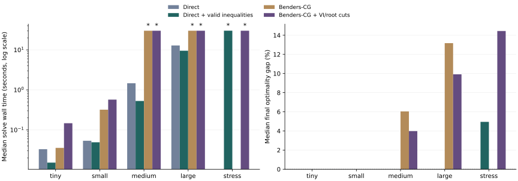

# MLND_Path 算法测试简报

本轮结果支持将**加强后的直接 MISOCP**作为当前求解基线。Benders＋列生成在微型和小型问题上求得一致结果；进入中型后，主要困难是收紧整数选址的全局下界。列生成本身运行正常，当前尚未表现出整体速度优势。

已在 `MLND_Path` 分支建立独立实现；本报告汇总 **9 个实例、34 次算法运行**。测试使用合成几何、需求、费用、解析随机取餐期望和目的柜 Logit，包含实际换电和连续电量约束。

## 1. 测试口径与规模

统一单线程，每次总求解预算 30 秒，目标相对最优性间隙 0.01%。路径预处理单独计时，也在原始 JSON 中给出端到端耗时。每个实例的算法顺序轮换；正式计时顺序执行，避免并行求解相互争用。环境：Python 3.13.9、Gurobi 13.0.2、macOS-26.6.2-arm64-arm-64bit-Mach-O。

| 规模 | L/H/OD/远程换电站 | 种子数 | 服务列数 | 预处理时间中位数／秒 |
|---|---|---:|---:|---:|
| 微型 | 2/3/2/1 | 2 | 64–68 | 0.004 |
| 小型 | 2/4/4/1 | 2 | 272–280 | 0.007 |
| 中型 | 3/5/8/1 | 2 | 3078–3104 | 0.081 |
| 较大型 | 3/6/12/2 | 2 | 9684–10026 | 0.470 |
| 扩展测试 | 4/8/24/2 | 1 | 81744 | 7.455 |

候选列通过“全部允许换电设施子集＋精确资源标签”生成，无人工跳数或 top-K 截断。该预处理精确保留当前无硬机队上限、仅设施激活约束的模型在每个整数设计下的运营值。CG 对固定候选列全集定价，包括经过当前关闭设施的列。完整证明和适用条件见 [实现说明](README.md)。

## 2. 求解效率

表内时间为同规模中位数；未达标组列出终止时自身的最优性间隙范围。达到时限的运行表示“在该预算下未完成证明”。

| 规模 | 直接 MISOCP | 加强后直接求解 | 基础 Benders＋CG | 加强 Benders＋CG |
|---|---|---|---|---|
| 微型 | 0.033 秒；全部达标 | 0.015 秒；全部达标 | 0.036 秒；全部达标 | 0.147 秒；全部达标 |
| 小型 | 0.054 秒；全部达标 | 0.049 秒；全部达标 | 0.321 秒；全部达标 | 0.571 秒；全部达标 |
| 中型 | 1.466 秒；全部达标 | 0.529 秒；全部达标 | 30.03 秒；gap 4.69%–7.40% | 30.03 秒；gap 3.49%–4.48% |
| 较大型 | 12.878 秒；全部达标 | 9.508 秒；全部达标 | 30.05 秒；gap 13.17%–13.17% | 30.04 秒；gap 9.01%–10.83% |
| 扩展测试 | — | 30.11 秒；gap 4.95%–4.95% | — | 30.04 秒；gap 14.44%–14.44% |

| 算法 | 达到 0.01% 精度的实例数 |
|---|---:|
| 直接 MISOCP | 8/8 |
| 加强后直接求解 | 8/9 |
| 基础 Benders＋CG | 4/8 |
| 加强 Benders＋CG | 4/9 |

图中星号表示该组包含在 30 秒预算内未达到目标间隙的运行。

加强后的直接求解增加来源流量与可用率的线性凸包、按 OD 拆分的设施激活约束。加强 Benders 同时使用这些约束、根节点分数设计割，以及整数分支中的 lazy Benders 割；两版均使用相同的完整候选列和机队／服务成本。

## 3. 解的质量与证明进度

“相对最佳已知解差”比较各算法找到的可行方案；“自身 gap”比较该算法的可行上界和全局下界。两列共同反映找到好方案的能力与证明最优性的进度。

| 实例 | 算法 | 可行目标值 | 全局下界 | 自身 gap | 相对最佳已知解差 | 秒 |
|---|---|---:|---:|---:|---:|---:|
| tiny_seed11 | 直接 MISOCP | 103.676657 | 103.676657 | 0.0000% | 0.0000% | 0.038 |
| tiny_seed11 | 加强后直接求解 | 103.676657 | 103.673091 | 0.0034% | 0.0000% | 0.021 |
| tiny_seed11 | 基础 Benders＋CG | 103.676657 | 103.676657 | 0.0000% | 0.0000% | 0.038 |
| tiny_seed11 | 加强 Benders＋CG | 103.676657 | 103.676653 | 0.0000% | 0.0000% | 0.190 |
| tiny_seed29 | 直接 MISOCP | 91.154321 | 91.152907 | 0.0016% | 0.0000% | 0.028 |
| tiny_seed29 | 加强后直接求解 | 91.154321 | 91.153541 | 0.0009% | 0.0000% | 0.010 |
| tiny_seed29 | 基础 Benders＋CG | 91.154321 | 91.154320 | 0.0000% | 0.0000% | 0.033 |
| tiny_seed29 | 加强 Benders＋CG | 91.154321 | 91.154320 | 0.0000% | 0.0000% | 0.104 |
| small_seed11 | 直接 MISOCP | 160.552007 | 160.536508 | 0.0097% | 0.0000% | 0.051 |
| small_seed11 | 加强后直接求解 | 160.552007 | 160.550348 | 0.0010% | 0.0000% | 0.051 |
| small_seed11 | 基础 Benders＋CG | 160.552007 | 160.552006 | 0.0000% | 0.0000% | 0.378 |
| small_seed11 | 加强 Benders＋CG | 160.552007 | 160.545624 | 0.0040% | 0.0000% | 0.659 |
| small_seed29 | 直接 MISOCP | 151.309681 | 151.309030 | 0.0004% | 0.0000% | 0.057 |
| small_seed29 | 加强后直接求解 | 151.309681 | 151.309030 | 0.0004% | 0.0000% | 0.047 |
| small_seed29 | 基础 Benders＋CG | 151.309681 | 151.309680 | 0.0000% | 0.0000% | 0.263 |
| small_seed29 | 加强 Benders＋CG | 151.309681 | 151.309680 | 0.0000% | 0.0000% | 0.483 |
| medium_seed11 | 直接 MISOCP | 260.229499 | 260.222523 | 0.0027% | 0.0000% | 1.398 |
| medium_seed11 | 加强后直接求解 | 260.229499 | 260.229497 | 0.0000% | 0.0000% | 0.469 |
| medium_seed11 | 基础 Benders＋CG | 263.549313 | 251.191731 | 4.6889% | 1.2757% | 30.029 |
| medium_seed11 | 加强 Benders＋CG | 260.229499 | 251.147593 | 3.4900% | 0.0000% | 30.035 |
| medium_seed29 | 直接 MISOCP | 263.998501 | 263.998501 | 0.0000% | 0.0000% | 1.535 |
| medium_seed29 | 加强后直接求解 | 263.998501 | 263.986742 | 0.0045% | 0.0000% | 0.589 |
| medium_seed29 | 基础 Benders＋CG | 269.292355 | 249.371579 | 7.3975% | 2.0053% | 30.032 |
| medium_seed29 | 加强 Benders＋CG | 263.998501 | 252.168195 | 4.4812% | 0.0000% | 30.023 |
| large_seed11 | 直接 MISOCP | 338.230396 | 338.199808 | 0.0090% | 0.0000% | 16.969 |
| large_seed11 | 加强后直接求解 | 338.230388 | 338.210837 | 0.0058% | 0.0000% | 12.185 |
| large_seed11 | 基础 Benders＋CG | 346.390940 | 300.755485 | 13.1746% | 2.4127% | 30.056 |
| large_seed11 | 加强 Benders＋CG | 343.858845 | 306.634409 | 10.8255% | 1.6641% | 30.039 |
| large_seed29 | 直接 MISOCP | 356.701510 | 356.678805 | 0.0064% | 0.0000% | 8.787 |
| large_seed29 | 加强后直接求解 | 356.701510 | 356.692214 | 0.0026% | 0.0000% | 6.831 |
| large_seed29 | 基础 Benders＋CG | 366.716910 | 318.408177 | 13.1733% | 2.8078% | 30.053 |
| large_seed29 | 加强 Benders＋CG | 360.148473 | 327.715837 | 9.0054% | 0.9663% | 30.046 |
| stress_seed11 | 加强后直接求解 | 656.447585 | 623.953072 | 4.9501% | 0.0000% | 30.107 |
| stress_seed11 | 加强 Benders＋CG | 658.246719 | 563.187967 | 14.4412% | 0.2741% | 30.039 |

## 4. 瓶颈在哪里

以下为同组中位数。“连续层”包含建模、原始／对偶求解及完整定价；“定价”是其中的子项，不能再次相加。活动列池比例按所有跨设计累计进入池的服务列计算。

| 规模 | 方法 | 连续子问题次数 | 连续层秒 | 主问题秒 | 定价秒 | 列池／全集 |
|---|---|---:|---:|---:|---:|---:|
| 微型 | 基础 Benders＋CG | 12 | 0.027 | 0.008 | 0.002 | 43.2% |
| 微型 | 加强 Benders＋CG | 48 | 0.129 | 0.015 | 0.005 | 44.0% |
| 小型 | 基础 Benders＋CG | 72 | 0.262 | 0.057 | 0.013 | 42.0% |
| 小型 | 加强 Benders＋CG | 104 | 0.490 | 0.075 | 0.018 | 32.4% |
| 中型 | 基础 Benders＋CG | 1294 | 23.477 | 6.514 | 1.028 | 37.0% |
| 中型 | 加强 Benders＋CG | 1200 | 23.208 | 6.765 | 0.885 | 28.1% |
| 较大型 | 基础 Benders＋CG | 612 | 27.326 | 2.670 | 1.934 | 22.6% |
| 较大型 | 加强 Benders＋CG | 568 | 27.659 | 2.272 | 1.550 | 15.8% |
| 扩展测试 | 加强 Benders＋CG | 64 | 29.227 | 0.182 | 3.121 | 8.7% |

当前实现每轮重建受限 SOCP 及显式对偶，列系数矩阵缓存并跨整数设计复用列池。定价采用完整候选列扫描；候选全集仍保存在内存中。这组测试说明，减少活动列并不自动减少外层所需的选址评价次数。

下一步建议保留加强后的直接求解作为对照，优先研究来源分配与可用率的分解界，并减少重复建模。根节点割和按 OD 激活已经实现，可以据此继续做单项对照。隐式资源路径定价可在候选列存储成为瓶颈时接入。

另外完成了循环 Benders 和核心点选割的开发预实验。核心点选割在个别设计上改善了割值，但单个中型算例的额外求解开销未带来整体改善，因此本轮默认对照采用上述四种方法。

## 5. 运营机制确实进入了解

每个实例选择本轮目标值最低的可行方案，重算以下指标。服务、自取、送家、跨基地和空程均为每小时流量；换电为每小时次数。

| 实例 | 开放 L/H/远程换电站 | 无人机服务 | 自取／送家 | 远程换电 | 跨基地服务 | 空重定位 |
|---|---|---:|---:|---:|---:|---:|
| large_seed11 | 2/6/1 | 33.38 | 24.49/8.89 | 32.07 | 22.75 | 0.00 |
| large_seed29 | 2/6/1 | 37.41 | 28.41/9.00 | 32.32 | 23.09 | 0.00 |
| medium_seed11 | 1/5/1 | 24.13 | 17.86/6.27 | 38.45 | 0.00 | 0.00 |
| medium_seed29 | 1/5/1 | 25.39 | 19.78/5.61 | 40.53 | 0.00 | 0.00 |
| small_seed11 | 1/4/1 | 12.24 | 8.02/4.21 | 24.00 | 0.00 | 0.00 |
| small_seed29 | 1/4/1 | 11.50 | 9.08/2.41 | 20.89 | 0.00 | 0.00 |
| stress_seed11 | 4/8/1 | 72.24 | 52.59/19.66 | 24.95 | 72.24 | 2.06 |
| tiny_seed11 | 1/3/1 | 6.39 | 3.91/2.48 | 12.78 | 0.00 | 0.00 |
| tiny_seed29 | 1/3/1 | 5.29 | 3.85/1.44 | 10.58 | 0.00 | 0.00 |

## 6. 正确性与复算

13 项独立测试全部通过，覆盖单基地解析最优值、跨设计割、空列池可行、基准／加强整数模型等价、跨阶段电量、必须空返的两基地场景，以及超时后的上界与状态处理。另对 2 个种子、合计 288 个固定组合进行独立路径穷举；标签法和列并集的最优费用最大差为 1.78×10⁻¹⁵。

全部正式结果的最大原始约束残差为 **3.27e-06**，根据订单、流量和机队重算目标的最大误差为 **2.78e-09**。所有实例的算法下界均不超过跨算法最佳可行上界。实验启动时记录的计算模块哈希与交付源码逐一匹配。

原始配置、种子、逐算法解与迭代轨迹见 `benchmarks` 下的正式实验目录；运行入口为 `python -m mlnd_path.benchmark`，测试入口为 `python -m pytest tests/test_mlnd_path.py -q`。
