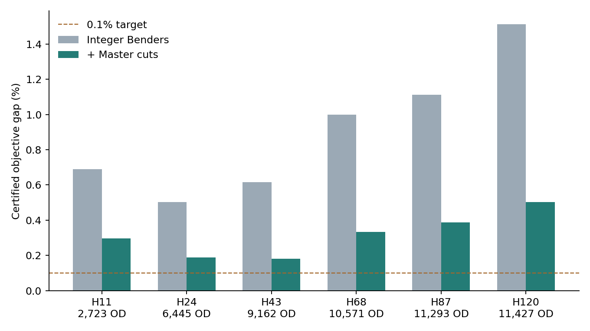
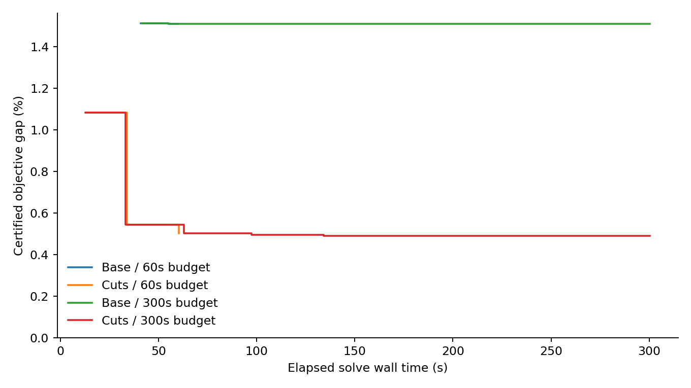

# MLND_Path：整数主问题与南山全量规模实验

本轮完成 **14 次南山全量实验**。主问题始终保留设施与 OD 基地对二元决策，只有一个连续的成本估计变量；可用率、idle 与空返全部留在子问题。最大档含 **11,427 个 OD、731,469 个二元变量**，未抽样订单、未缩放需求、未使用 top-k 航廊筛选。

60 秒预算的六档对照中，加强割在 **6/6 档**取得更高下界。最大档本轮最小认证间隙为 **0.491%**，实际用时 **300.3 秒**。0/14 次运行达到设定的 0.1% 目标间隙。

[模型、路径算法与割的完整说明](METHOD.html) · [全候选对偶补全推导](integer_cuts_design.html) · [历史数据与参数审计](data_audit.html)

## 1. 六档完整数据

| 档位 | 基地／柜／换电点 | OD 数 | 订单/h | 主问题二元变量 | 基础路径组合数，不含换电变体 |
|---|---:|---:|---:|---:|---:|
| H11 | 2 / 11 / 2 | 2,723 | 2,114.71 | 10,907 | 1,198,120 |
| H24 | 2 / 24 / 3 | 6,445 | 4,906.86 | 25,809 | 14,230,560 |
| H43 | 3 / 43 / 5 | 9,162 | 6,828.57 | 82,509 | 148,919,148 |
| H68 | 5 / 68 / 7 | 10,571 | 7,726.29 | 264,355 | 1,204,036,900 |
| H87 | 6 / 87 / 9 | 11,293 | 8,153.00 | 406,650 | 3,041,792,136 |
| H120 | 8 / 120 / 13 | 11,427 | 8,196.71 | 731,469 | 10,443,363,840 |

最大档的基础组合数约 **104.43 亿**。实现通过分阶段资源状态与最短路共享计算，直接取得每个 OD—基地对的最低任务成本，不建立这些组合对应的变量或路径字典。所有候选基地、柜、换电点均参与。

## 2. 60 秒预算：主问题加割对照

两种方法采用相同的隐式精确定价、连续子问题、初始方案和数据；加强版增加共享 idle 子模割与两个柜的成本覆盖割。表中列出实际耗时；求解器部分运行在设定预算之后返回。

| 档位 | 基础版 UB / LB | 基础 gap | 基础实际秒 | 加强版 UB / LB | 加强 gap | 加强实际秒 |
|---|---:|---:|---:|---:|---:|---:|
| H11 | 13,365.61 / 13,273.50 | 0.689% | 60.0 | 13,365.61 / 13,325.97 | 0.297% | 60.0 |
| H24 | 31,162.59 / 31,005.69 | 0.503% | 70.8 | 31,162.59 / 31,103.96 | 0.188% | 75.9 |
| H43 | 42,038.84 / 41,779.72 | 0.616% | 60.1 | 42,037.89 / 41,961.65 | 0.181% | 60.1 |
| H68 | 46,826.67 / 46,358.35 | 1.000% | 60.1 | 46,826.67 / 46,670.46 | 0.334% | 60.1 |
| H87 | 49,165.74 / 48,619.01 | 1.112% | 60.4 | 49,165.74 / 48,975.70 | 0.387% | 60.1 |
| H120 | 48,780.75 / 48,043.36 | 1.512% | 60.2 | 48,780.75 / 48,536.10 | 0.502% | 60.5 |

UB 是可行方案成本，LB 是全局下界，单位均为 CNY/h；gap = (UB−LB)/UB。

## 3. 最大档延长实验

| 方法／预算 | 实际秒 | 可行成本 UB | 全局下界 LB | gap | Benders 割 | 动态及初始 idle 割 |
|---|---:|---:|---:|---:|---:|---:|
| 基础 / 60s | 60.2 | 48,780.75 | 48,043.36 | 1.512% | 20 | 0 |
| 加强 / 60s | 60.5 | 48,780.75 | 48,536.10 | 0.502% | 32 | 17 |
| 基础 / 300s | 300.2 | 48,780.75 | 48,044.33 | 1.510% | 87 | 0 |
| 加强 / 300s | 300.3 | 48,780.75 | 48,541.24 | 0.491% | 70 | 43 |

## 4. 实际加了什么割

1. **共享 idle 子模割。** 把同一基地的 OD 服务收益合并后，对 idle 函数取一维最小值，再生成只含分配二元变量的线性下界。它在当前整数分配处计入一个共享的 idle 成本。
2. **两个柜的成本覆盖割。** 只有零个或一个柜开放时，服务任务无法经过两个不同柜，成本回到全骑手基准。该事实写入成本下界，保留所有选址下的运营补救。
3. **完整运营 Benders 割。** 当前开放路径由精确最短任务求解；其余路径由全设施开放的组最低成本及设施激活罚价补全，对所有候选路径形成全局证书。

主问题还使用聚合的起点／终点基地开放链接。两种测试方法均已包含这些链接和原有的按 OD 分摊 idle 初始下界。

## 5. 计算时间现在花在哪里

| H120 方法／预算 | 建模及首次定价秒 | 全部定价秒 | 全部凸内层秒 | 凸内层次数 | 总秒 |
|---|---:|---:|---:|---:|---:|
| 基础 / 60s | 3.36 | 3.33 | 0.74 | 21 | 60.15 |
| 加强 / 60s | 3.85 | 2.87 | 1.34 | 33 | 60.45 |
| 基础 / 300s | 3.41 | 8.63 | 3.69 | 88 | 300.21 |
| 加强 / 300s | 3.76 | 5.22 | 2.77 | 71 | 300.32 |

建模及首次定价与“全部定价”部分重叠，不能逐列相加。总时间包含主问题搜索、割构造、定价及内层求解。当前连续内层只随基地数增长，进一步加速的重点是整数主问题的下界和搜索。

## 6. 当前方案与参数口径

| 档位（60 秒加强版） | 开放 L/H/E | 机队（连续） | 无人机服务单/h | 服务占比 | 成本节约区间 CNY/h |
|---|---:|---:|---:|---:|---:|
| H11 | 2/11/0 | 500.1 | 1,360.9 | 64.4% | [594.3, 633.9] |
| H24 | 2/24/0 | 1,084.2 | 2,912.4 | 59.4% | [1,645.0, 1,703.7] |
| H43 | 3/42/0 | 2,007.4 | 5,472.2 | 80.1% | [3,909.7, 3,985.9] |
| H68 | 5/68/0 | 2,434.4 | 6,717.3 | 86.9% | [5,381.9, 5,538.1] |
| H87 | 6/87/0 | 2,650.2 | 7,337.3 | 90.0% | [6,080.5, 6,270.6] |
| H120 | 8/120/0 | 2,682.3 | 7,535.0 | 91.9% | [6,801.4, 7,046.1] |

机队按 idle 数量加任务流量乘平均占用时间计算，取餐前的同步等待也计入占用。此版本采用连续机队且没有柜服务率上限，服务量与历史有限服务率柜模型相应变化。

成本、72 km/h 速度、10 km 航程、3 min 换电和末端 utility 沿用历史最终配置。骑手 18 km/h 与空返时钟 κ=30/h 沿用路径原型设置。原始时钟得到的经验前置时间分布只通过期望进入路径系数；没有增加场景变量。完整来源及各参数处理见数据审计与方法说明。

参数迁移还显示了两个值得继续检查的机制。H120 的 60 秒方案开启 8 个基地、120 个柜、0 个外部换电点，设施小时费用为 **232 CNY/h，约占总成本 0.48%**；当前最好方案倾向于多开柜。其约 7,535 单/h 的服务量乘 15.394 min 前置时间，在任务时间分解中对应约 **1,933 架**的占用，占总机队约 **72%**。后续选址研究可重点检查设施费与接驳费的敏感性，以及订单何时开始占用无人机；这两项会直接改变开站和机队配置。

## 7. 正确性、复现与后续重点

28 项相关测试通过，包括资源路径独立枚举、经验期望、子模割，以及 272 个战略设计之间的 73,984 次运营割检验。所有 14 个保存方案均重新计算路径、成本、机队与流量平衡；总体验证结果为 **通过**。最大约束残差 2.69e-20，最大成本重算误差 1.16e-10 CNY/h。

后续算法工作继续保持整数战略主问题：在分数节点分离共享 idle 割，强化关闭设施的成本罚价，并针对基地流量平衡生成更强的投影下界。本轮先建立全量运行、严格上下界与可复核的加割对照。

- [逐运行汇总 CSV](summary.csv)
- [方案与跨方法下界验证](validation.json)
- [60 秒实验清单](formal_60s/manifest.json)
- [300 秒实验清单](extended_300s/manifest.json)

复现入口：`python -m mlnd_path.benchmark_nanshan`。最大档延长实验：`python -m mlnd_path.benchmark_nanshan --levels 120 --seconds 300 --output mlnd_path/nanshan_integer_20260914/extended_300s`。实验位于 `MLND_Path` 分支；原论文正文保持原样。
